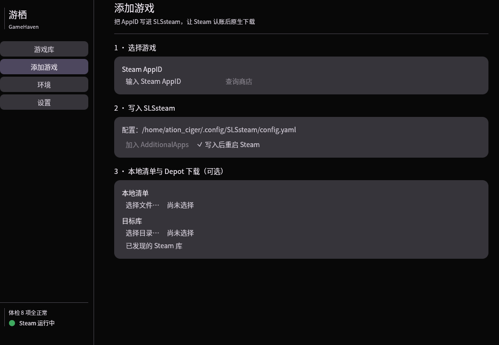
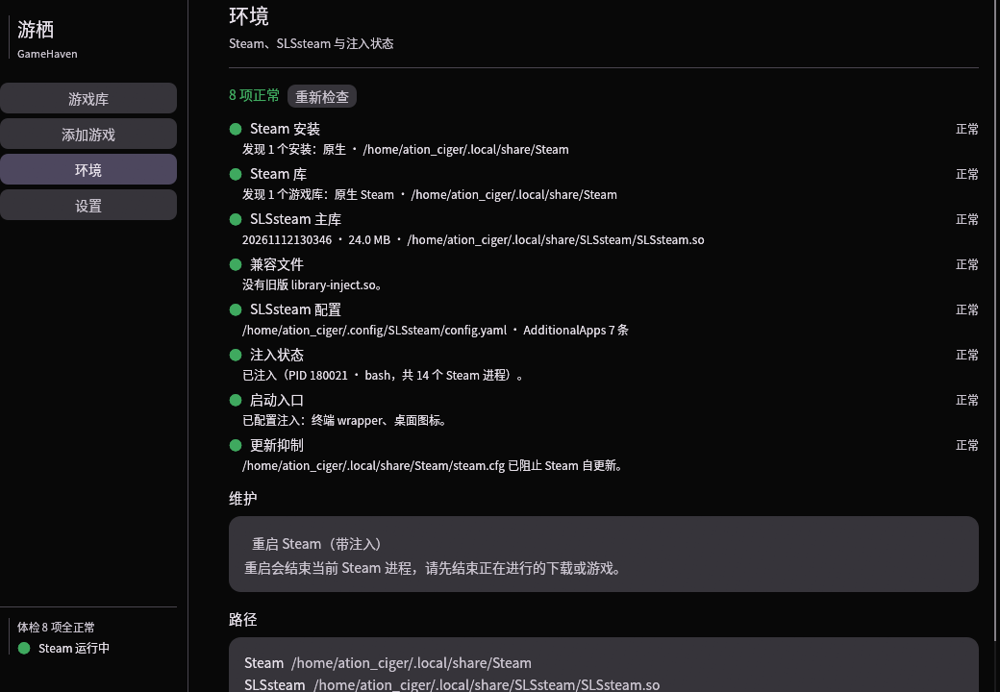

# 游栖 · GameHaven

Linux 原生的 Steam 工具箱。对标 OpenSteamTool 的功能集，但用 Rust、egui 和 Material Design 3 重做界面：不依赖 WebView，不需要 Python，也没有 .NET 运行时。

X11 与 Wayland 都可以运行。

## 定位

- **Linux 优先**：识别原生、Flatpak 和 Snap 的 Steam 安装与游戏库，直接管理 SLSsteam 注入。
- **纯 Rust**：窗口、控件、渲染都在 Rust 里，只依赖系统图形栈。
- **可解释**：每个检查项和写操作都有明确说明；改 `config.yaml` 保留注释、自动备份、原子写入。
- **不重造下载器**：解锁之后交给 Steam 客户端下载，CDN、校验、断点和 Proton 都由它处理。

## 当前功能

| 页面 | 能做什么 |
| --- | --- |
| 游戏库 | 发现原生 / Flatpak Steam 库，统计安装记录 |
| 添加游戏 | 查询商店信息；把 AppID 写入 SLSsteam 的 `AdditionalApps`，可选写入后重启 Steam；解析本地清单并匿名下载单个 Depot |
| 环境 | 8 项体检：Steam 安装、游戏库、SLSsteam 主库、兼容文件、配置文件、注入状态、启动入口、更新抑制；一键重启 Steam 并校验注入 |
| 设置 | 自动重启开关、Steam / SLSsteam / 配置路径 |





## 构建

需要 Rust 1.100 或更新版本（`egui_mineral_material` 的 MSRV）。

```bash
cargo run --locked
```

运行环境：

- Steam 客户端（原生或 Flatpak）。首次使用前先启动并登录一次。
- SLSsteam，用于解锁和注入。程序会检测安装位置、版本和 `LD_AUDIT` 是否生效。
- 可选：`smd` 与 `DepotDownloader`，只在本地清单解析和匿名 Depot 下载时使用。可通过 `GAMEHAVEN_SMD`、`GAMEHAVEN_DEPOT_DOWNLOADER` 指定绝对路径。

## 注入是怎么生效的

SLSsteam 通过 `LD_AUDIT` 在 Steam 启动时加载。程序不修改 Steam 二进制，只做三件事：

1. 检查 `~/.local/share/SLSsteam/SLSsteam.so` 是否存在且非空；
2. 检查桌面图标和 `~/.local/bin/steam` 是否带注入；
3. 需要时结束 Steam，再从带注入的入口重新启动，并在 `/proc/<pid>/maps` 里确认 `SLSsteam.so` 已加载。

体检页会指出「装了但没注入」这类问题，而不是让游戏停在「库里看得见、下载走不通」的状态。

## 路线

下一阶段聚焦清单版本、DLC 批量登记和库页游戏卡。完整计划见 [docs/roadmap.md](docs/roadmap.md)。

## 许可证

GPL-3.0-or-later。界面组件使用 [egui_mineral_material](https://github.com/lajosbencz/egui_mineral)（GPL-3.0-or-later），因此本项目整体按 GPL-3.0 发布。
